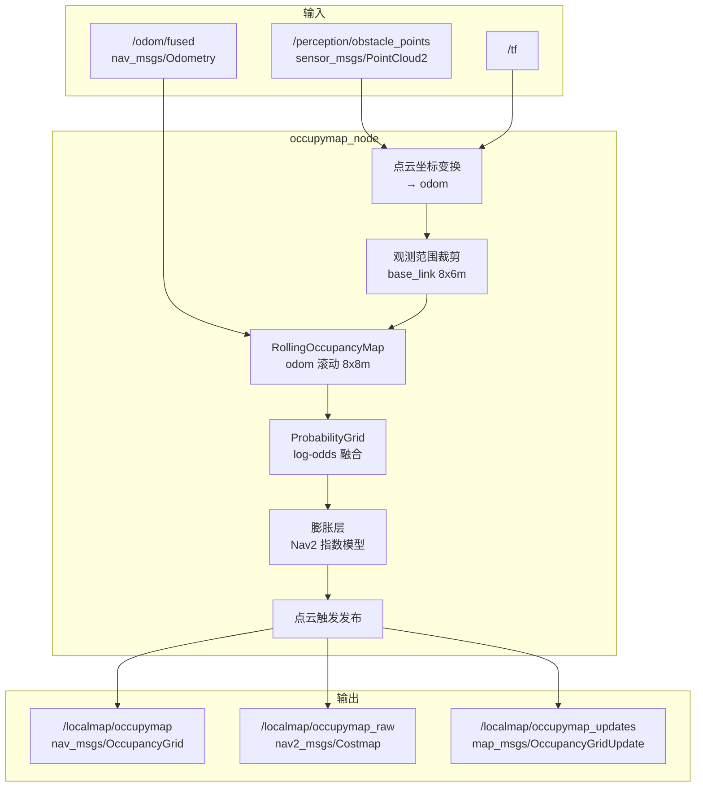

# localmap_occupymap 算法架构

本文档描述 `localmap` 项目（**v0.1.0**）中局部占据地图模块 `localmap_occupymap` 的整体架构、数据流，以及与 Nav2 `local_costmap` 的对比。车端编译与运行见 [deployment.md](deployment.md)。

## 1. 项目定位

`localmap_occupymap` 是一个独立的 ROS2 包，用于替代或并行于 Nav2 `nav2_costmap_2d`，根据机器人行走时的里程计与障碍物点云，在 `odom` 坐标系下维护滚动局部代价地图，并发布与 Nav2 costmap 兼容的三类话题，供 MPPI 等规划模块通过话题接入。

**设计参考：**

- 占据更新：Cartographer 2D 概率栅格（log-odds + 射线投射）
- 话题接口：Nav2 `Costmap2DPublisher`（`costmap` / `costmap_raw` / `costmap_updates`）
- 膨胀模型：Nav2 指数衰减（`cost_scaling_factor`）

## 2. 目录结构

```
localmap/
├── VERSION
├── src/localmap_occupymap/          # ROS2 包源码
│   ├── include/localmap_occupymap/
│   │   ├── probability_grid.hpp     # 概率栅格核心
│   │   ├── rolling_occupancy_map.hpp
│   │   ├── occupymap_node.hpp
│   │   └── cost_value.hpp           # Nav2 代价值常量
│   ├── src/
│   ├── config/occupymap.param.yaml
│   └── launch/occupymap.launch.py
├── script/                          # 构建/运行脚本
└── docs/
    ├── architecture.md
    └── deployment.md
```

## 3. 整体架构



## 4. 数据流与处理流程

### 4.1 输入订阅

| 话题 | 类型 | 用途 |
|------|------|------|
| `/odom/fused` | `nav_msgs/Odometry` | 滚动窗口原点、静止判定、TF 回退 |
| `/perception/obstacle_points` | `sensor_msgs/PointCloud2` | 障碍物点云观测 |
| `/tf` | `tf2_msgs/TFMessage` | 将点云变换到 `odom`（失败时回退用 odom 位姿） |

### 4.2 点云预处理

1. 优先通过 `tf2` 将点云变换到 `map_frame`（默认 `odom`）
2. TF 不可用时，使用 `/odom/fused` 位姿将点云变换到 `odom`
3. 在 `base_link` 下按 `observe_extent_*` 裁剪观测范围（前后 4 m、左右 3 m）
4. 其他过滤：
   - Z 高度：`min_z_m` ~ `max_z_m`
   - 最大距离：`max_range_m`

地图滚动窗口由 `map_extent_*` 定义（前后/左右各 4 m，共 8 m × 8 m），与观测范围独立。

### 4.3 概率栅格更新（Cartographer 风格）

参考 Cartographer `ProbabilityGridRangeDataInserter2D` 的思路：

```
障碍物点云帧
    │
    ├─ Hit：命中栅格 log-odds += log(hit_prob / (1-hit_prob))   [默认 hit=0.55]
    │
    └─ Miss：Bresenham 射线投射，沿途栅格 log-odds += log(miss_prob/(1-miss_prob))  [默认 miss=0.49]
```

要点：

- 每帧扫描内用 `update_marker` 防止同一栅格重复更新（hit 优先于 miss）
- 概率钳位在 `[0.1, 0.9]`
- 每格记录 `last_hit_time`，用于静止保持

### 4.3.1 车体足迹与侧后盲区

车体在 `base_link` 下尺寸为 1 m × 1 m（后轴中心为原点，前缘 x=0.9 m，后缘 x=-0.1 m，半宽 0.5 m）。

| 区域 | 条件 | 处理方式 |
|------|------|----------|
| 车体内 | 足迹范围内 | 丢弃 |
| 足迹外（含前方与侧后） | 有障碍物点云 | 正常 hit_prob 概率更新 + 射线 free space |

**盲区保持策略**：自车向前行驶时，栅格进入侧后盲区（足迹外且 x ≤ 0.9 m）。若该格已被 hit_prob 判定为占据、但后续进入无点云覆盖的盲区，则进入时锁定占据状态，保持 `blind_zone_retention_sec`（默认 10 s），期间射线 miss 不削弱该格，输出强制为 occupied / lethal。

### 4.4 静止保持策略

当机器人判定为静止（线速度 < 0.05 m/s 且角速度 < 0.05 rad/s）时：

- 仅保留最近 `stationary_retention_sec`（默认 10 s）内被 hit 过的占据状态
- 超时未更新的占据格：若 `track_unknown_space=true` 退化为 unknown；**v0.1.0 默认 `false`，退化为 free**
- 自由空间格仍显示为 free

运动时：按完整 log-odds 概率正常输出，不做时间窗口裁剪。

### 4.5 输出转换（与 Nav2 Costmap2DPublisher 一致）

三个话题与 Nav2 `local_costmap` 对齐：

| 本模块话题 | Nav2 话题 | 消息类型 | frame_id |
|-----------|----------|----------|----------|
| `/localmap/occupymap` | `/local_costmap/costmap` | `nav_msgs/OccupancyGrid` | `odom` |
| `/localmap/occupymap_raw` | `/local_costmap/costmap_raw` | `nav2_msgs/Costmap` | `odom` |
| `/localmap/occupymap_updates` | `/local_costmap/costmap_updates` | `map_msgs/OccupancyGridUpdate` | `odom` |

- **坐标系**：`map_frame=odom`，滚动窗口随机器人在 `odom` 中平移（与 Nav2 `global_frame` 一致）
- **原点**：`mapToWorld(0,0) - resolution/2`（Nav2 同款）
- **栅格尺寸**：`size_x=160`（odom X / 纵向 8 m），`size_y=160`（odom Y / 横向 8 m），分辨率 0.05 m
- **可视化栅格**：由 0~255 cost 经 `cost_translation_table` 映射为 -1~100（与 Nav2 一致）
- **raw costmap**：`metadata.layer=master`，`data` 为 0~255 Nav2 代价值
- **增量更新**：`OccupancyGridUpdate.data` 同样使用 cost 翻译表（非 raw 0~255）

#### `/localmap/occupymap`（可视化）

- 类型：`nav_msgs/OccupancyGrid`
- 值域：`-1` unknown，`0` free，`1~100` occupied（`track_unknown_space=false` 时无 unknown）

#### `/localmap/occupymap_raw`（规划/MPPI）

- 类型：`nav2_msgs/Costmap`
- 值域（Nav2 标准）：

| 值 | 含义 |
|----|------|
| 0 | 自由 |
| 1~252 | 膨胀梯度代价 |
| 253 | inscribed（内切障碍） |
| 254 | lethal（致命障碍） |
| 255 | unknown（`track_unknown_space=false` 时不出现） |

生成流程：

1. 由 log-odds 分类为 free / lethal / unknown（或 free）
2. 对 lethal 格做圆形膨胀（`inflation_radius_m`、`inscribed_radius_m`）
3. 膨胀区域内按 Nav2 指数模型计算代价值：

```
cost = (253 - 1) * exp(-cost_scaling_factor * (dist - inscribed_radius))
```

其中 `cost_scaling_factor` 默认 10.0。

#### `/localmap/occupymap_updates`（增量）

- 类型：`map_msgs/OccupancyGridUpdate`
- 仅发布本帧点云更新影响的矩形区域（含膨胀边界）
- 订阅端合并到本地全图，降低带宽

### 4.6 发布策略

- **仅点云触发**：收到 `/perception/obstacle_points` 后立即发布，stamp 与点云 header 一致
- 无独立定时器（发布频率与点云一致，约 10 Hz）
- QoS：`transient_local` + `reliable`（与 Nav2 costmap 一致，晚订阅者可获得最新地图）

## 5. 地图参数（v0.1.0 默认）

| 参数 | 值 | 说明 |
|------|-----|------|
| `map_extent_*` | 各 4 m | odom 滚动窗口 8 m × 8 m → 160 × 160 |
| `observe_extent_forward/backward_m` | 4 m | 点云观测前后范围 |
| `observe_extent_left/right_m` | 3 m | 点云观测左右范围 |
| 分辨率 | 0.05 m | |
| 坐标系 | `odom` | 滚动局部地图 |
| `track_unknown_space` | false | 未观测区域输出 free |
| 车体足迹 | 1 m × 1 m | 前 x=0.9，后 x=-0.1，半宽 0.5 |
| 侧后盲区保持 | 10 s | 进入盲区后保留 hit_prob 占据 |
| 静止保持 | 10 s | 静止时占据状态保留窗口 |
| 膨胀半径 | 0.55 m | raw costmap 膨胀 |
| 内切半径 | 0.35 m | inscribed 代价边界 |
| `cost_scaling_factor` | 10.0 | Nav2 指数膨胀系数 |

## 6. 与 Nav2 local_costmap 对比

### 6.1 话题对照

| 本模块 | Nav2 local_costmap | 消息类型 | 用途 |
|--------|-------------------|----------|------|
| `/localmap/occupymap` | `/local_costmap/costmap` | `nav_msgs/OccupancyGrid` | 可视化 |
| `/localmap/occupymap_raw` | `/local_costmap/costmap_raw` | `nav2_msgs/Costmap` | MPPI / 碰撞检测 |
| `/localmap/occupymap_updates` | `/local_costmap/costmap_updates` | `map_msgs/OccupancyGridUpdate` | 增量更新 |

### 6.2 架构差异

| 维度 | localmap_occupymap | Nav2 local_costmap |
|------|-------------------|-------------------|
| 地图坐标系 | `odom` 滚动窗口 8×8 m | `odom`（global_frame）滚动窗口 |
| 占据来源 | 障碍物点云概率融合 | 多层插件（static、obstacle、inflation…） |
| 更新模型 | Cartographer log-odds + 射线 | 二值/概率障碍物层 + 膨胀层 |
| 膨胀 | Nav2 指数模型 | Nav2 指数模型 |
| 发布 | 点云触发 | 定时 + 层更新 |
| 静止保持 | 10 s 时间窗口 | 无（依赖滚动窗口自然淘汰） |
| unknown 语义 | 默认 false（全 free） | 可配置 |
| 下游接入 | **ROS 话题** | **进程内** `Costmap2DROS` 指针 |
| 静态地图 | 不支持 | 支持 static_layer |
| 足迹裁剪 | 不支持 | 支持 footprint 清除 |

### 6.3 相同点

- 三个话题的消息类型、frame_id（`odom`）、QoS（transient_local）与 Nav2 一致
- `occupymap` / `occupymap_updates` 使用 Nav2 `cost_translation_table` 映射
- `occupymap_raw` 使用 Nav2 0~255 代价语义，含指数膨胀梯度，`layer=master`
- 提供全图 + 增量更新两套输出

### 6.4 MPPI 接入方式

标准 Nav2 MPPI 通过 `Costmap2DROS` 共享内存访问 costmap，**不订阅话题**。

本模块面向**自定义 MPPI 或话题化规划栈**，推荐订阅：

```yaml
costmap_topic: /localmap/occupymap_raw
costmap_update_topic: /localmap/occupymap_updates
```

订阅端逻辑：

1. 首次收到 `Costmap` → 初始化本地 `uint8[]` 代价数组
2. 收到 `OccupancyGridUpdate` → 将变化矩形写入对应位置
3. 规划时用 0~255 代价做轨迹评分与碰撞检测

## 7. 核心类职责

```
occupymap_node
  ├─ 订阅 odom / 点云，管理 TF
  ├─ 点云回调驱动 publishMap
  └─ 发布 3 个话题

RollingOccupancyMap
  ├─ 参数与线程安全封装
  ├─ 点云过滤（observe_extent）与 odom 滚动窗口（map_extent）
  └─ 调用 ProbabilityGrid 更新与导出

ProbabilityGrid
  ├─ log-odds 存储与贝叶斯更新
  ├─ Bresenham 射线投射
  ├─ 静止时间窗口过滤
  ├─ Nav2 指数膨胀代价生成
  └─ 导出 OccupancyGrid / Costmap / OccupancyGridUpdate
```

## 8. 参考

- Cartographer 概率栅格
- Nav2 costmap 发布：`nav2_costmap_2d/src/costmap_2d_publisher.cpp`
- Nav2 膨胀层：`nav2_costmap_2d/plugins/inflation_layer.cpp`
