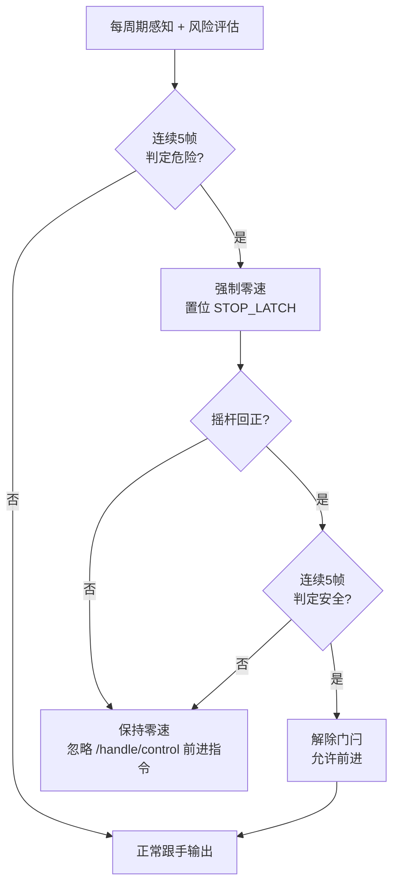

# 摇杆回正 + 连续五帧确认 vs safety_node 现有方案

> 分析范围：`src/scene/safety_node`  
> 日期：2026-06-17  
> 对照代码版本：当前主分支（控制频率默认 50 Hz）

---

## 1. 背景与问题

在低速室内轮椅/代步车场景中，避障停车后的**再起步行为**直接影响两类体验：

1. **安全性**：驾驶员未意识到障碍已清除，仍保持推杆前进时，系统是否应立即放行？
2. **舒适性**：障碍在检测阈值附近抖动时，车辆是否会在「冲—停—冲」之间振荡？

本文对比两套思路：


| 编号             | 方案               | 核心规则                                                     |
| -------------- | ---------------- | -------------------------------------------------------- |
| **方案 P**（待评估）  | 摇杆回正 + 五帧确认      | ① 每次避障停车后，必须摇杆回正才能再次前进；② 决策依据连续 5 帧数据                    |
| **方案 C**（当前实现） | safety_node 混合避障 | Footprint 选速 + LocalMap 否决 + 时间滞回 + 可选脱困，**不要求**摇杆回正即可恢复 |


---

## 2. 方案 P：摇杆回正 + 连续五帧确认

### 2.1 规则定义（建议语义）

**规则 1 — 避障停车后摇杆回正门闩（Joystick Re-arm Gate）**

```
避障触发停车（emergency_brake 或等效零速）
    → 进入 LATCHED 状态
    → 即使障碍消失、/handle/control 仍保持前进指令，也继续输出零速
    → 仅当 /sensor/joystick 连续处于死区内（driver_neutral=true）
       才解除门闩，允许下一次前进
```

**规则 2 — 连续五帧数据确认（5-Frame Consensus）**

在 50 Hz 控制环下，5 帧 ≈ **100 ms**。可对以下两类事件做帧级投票：


| 事件       | 五帧确认条件                            | 典型用途              |
| -------- | --------------------------------- | ----------------- |
| **触发停车** | 连续 5 帧 `risk.unsafe == true`      | 抑制单帧噪点/偶发漏检反弹     |
| **允许恢复** | 连续 5 帧 `risk.safe == true` 且门闩已解除 | 替代纯时间滞回，与感知帧率对齐   |
| **感知输入** | 滑动窗口保留最近 5 帧障碍场快照                 | 对障碍存在性做 AND/OR 投票 |


> 注：五帧窗口可与规则 1 串联——先五帧确认「确实该停」，停车后等摇杆回正，再三帧或五帧确认「确实可走」。

### 2.2 方案 P 数据流（示意）




### 2.3 方案 P 优点


| 维度           | 说明                                                        |
| ------------ | --------------------------------------------------------- |
| **意图明确**     | 再起步 = 一次新的驾驶动作，强迫驾驶员「松手再推」，降低「人没注意、车先走」的风险                |
| **状态机简单**    | `STOP_LATCH → NEUTRAL → CLEAR_5F → GO` 易于测试、日志可读、与非技术用户沟通 |
| **与帧率对齐**    | 五帧确认直接绑定控制周期，不依赖绝对秒数，换频率时行为可预期（5 帧恒为 100 ms@50Hz）         |
| **抑制单帧毛刺**   | 对激光偶发噪点、TF 单帧跳变有天然滤波效果                                    |
| **降低自动续行争议** | 障碍刚消失时，若驾驶员仍满杆，车不会自己往前「溜」，符合部分安全规范对「人工确认」的要求              |


### 2.4 方案 P 缺点


| 维度            | 说明                                                                  |
| ------------- | ------------------------------------------------------------------- |
| **操作负担**      | 每次停车都要回中再推，窄道/跟车流场景下频繁打断，驾驶员疲劳感上升                                   |
| **与上层控制冲突**   | `/handle/control` 可能来自巡航/导航栈，仅看原始摇杆回正会忽略「软件仍在发前进指令」的语义              |
| **脱困路径受阻**    | 贴障场景需要自动后退/转向脱困时，强制回正会打断 recovery 连续动作                              |
| **延迟叠加**      | 五帧确认触发（100 ms）+ 停车 + 回正操作（人为主观 0.3–1 s）+ 五帧确认释放（100 ms），再起步明显慢于自动恢复 |
| **摇杆话题单点依赖**  | `joystick_timeout_s` 超时后 `driver_neutral=false`，门闩可能**永远无法解除**      |
| **五帧对运动障碍不足** | 静态噪点可滤，但对快速切入的动态障碍，100 ms 确认反而增加制动距离                                |
| **窗口语义需额外定义** | 五帧是「5 次控制 tick」还是「5 次雷达帧」？多雷达不同步时投票规则复杂                             |


---

## 3. 方案 C：safety_node 现有实现

### 3.1 整体架构

当前生产默认模式为 `safe_assist`（50 Hz），单周期链路：

```
VehicleIo 读入 → LidarPerception 构建 ObstacleField（每源最新一帧）
    → AvoidanceController（Footprint 候选 + Map veto + 制动包络 + 急停 + Recovery）
    → OutputShaper（斜率限制 / 急停保持）
    → /nav/control
```

### 3.2 摇杆回正：当前**做了什么**

原始摇杆 `/sensor/joystick` 在 `VehicleIo::desiredControl()` 中处理：

```69:75:src/scene/safety_node/src/vehicle_io.cpp
  out.driver_neutral =
    joystick_fresh &&
    std::abs(static_cast<int>(joystick_.rocker_x)) <= deadzone &&
    std::abs(static_cast<int>(joystick_.rocker_y)) <= deadzone;
  if (out.driver_neutral) {
    out.twist = geometry_msgs::msg::Twist{};
  }
```

在 `SafetyNode::onControlTick()` 中：

```631:638:src/scene/safety_node/src/safety_node.cpp
  if (control.driver_neutral && !result.emergency_brake) {
    shaped = output_shaper_.lowPassToZero(
      dt_s, params_.neutral_stop_filter_time_constant_s);
  } else {
    shaped = output_shaper_.shape(
      result.safe_twist, dt_s, result.emergency_brake, result.recovery_active, hard_emergency);
  }
```

**关键结论：**


| 场景            | 是否要求摇杆回正                                                      |
| ------------- | ------------------------------------------------------------- |
| 驾驶员主动停车（摇杆回中） | 是 — 回中后低通收敛到零，覆盖 `/handle/control` 残留指令                       |
| 避障/急停被动停车     | **否** — `emergency_brake=true` 时**不走** `lowPassToZero` 分支     |
| 风险解除后再前进      | **否** — 只要 `emergency_brake` 变 false 且过了释放延迟，**手柄保持前推即可自动恢复** |


急停释放由 `OutputShaper` 的 `emergency_holding_` 管理：

```110:121:src/scene/safety_node/src/output_shaper.cpp
  } else if (emergency_holding_) {
    const double valid_dt_s = std::isfinite(dt_s) ? std::max(0.0, dt_s) : 0.0;
    emergency_clear_time_s_ += valid_dt_s;
    if (emergency_clear_time_s_ < emergency_release_delay_s_) {
      last_ = geometry_msgs::msg::Twist{};
      ...
      return last_;
    }
    emergency_holding_ = false;
```

默认 `emergency_release_delay_s = 0.15 s`（约 7–8 个控制周期），**不是**摇杆回正，而是**固定时间保持零速**。

`recovery_active` 脱困命令**绕过**该等待（见 YAML 注释），进一步说明系统优先考虑自动脱离而非人工回正。

### 3.3 多帧/时间确认：当前**做了什么**

当前**没有**「连续 5 帧障碍场滑动窗口」。感知层每路雷达只保留**最新一帧**点云，控制层用当周期 ObstacleField 决策。

与「五帧确认」相近的是**时间积分**参数（50 Hz 下换算帧数供参考）：


| 参数                             | 默认值    | ≈帧数@50Hz | 作用                        |
| ------------------------------ | ------ | -------- | ------------------------- |
| `recovery_intrusion_confirm_s` | 0.10 s | ~5 帧     | 侵入型 recovery 启动前确认        |
| `emergency_clear_hold_s`       | 0.15 s | ~7 帧     | EmergencyBrake 风险消除后保持    |
| `emergency_release_delay_s`    | 0.15 s | ~7 帧     | OutputShaper 急停保持         |
| `candidate_speed_up_hold_s`    | 0.30 s | ~15 帧    | 障碍边缘恢复提速前保持               |
| `hard_stop_release_distance_m` | 0.20 m | —        | 净空滞回（大于 hard_stop 0.12 m） |


```63:93:src/scene/safety_node/src/core/emergency_brake.cpp
bool EmergencyBrake::releaseConditionsMet(...) const
{
  ...
  const double release_clearance =
    std::max(params_.hard_stop_distance_m, params_.hard_stop_release_distance_m);
  ...
  return ttc_clear && clearance_clear;
}
```

此外还有：

- **制动包络**：沿轨迹距离反算速度上限，提前减速而非突然零速
- **候选提速保持** `applyCandidateSpeedUpHold()`：障碍刚消失时不立刻满速
- **Recovery 状态机**：`CONFIRMING → ACTIVE → BLOCKED/ABORTED`，带进度/超时/轮速反馈检测

### 3.4 方案 C 优点


| 维度           | 说明                                                                  |
| ------------ | ------------------------------------------------------------------- |
| **连续驾驶体验**   | 障碍清除后自动恢复，无需回中，适合长距离室内通行                                            |
| **几何决策精细**   | Footprint 扫掠 + 候选排序 + Map veto，不是简单「有障碍就停」                          |
| **提前减速**     | 制动包络在硬停前平滑降速，减少「满速撞线急停」                                             |
| **脱困能力**     | 贴障时可自动低速后退/转向（recovery），不依赖驾驶员回正                                    |
| **多层滞回**     | 距离滞回 + 时间保持 + 提速保持，针对振荡有多道阻尼                                        |
| **已有实车数据验证** | SIM-002 等 bag 回放表明制动振荡比基线改善（见 `reports/SIM-002_replay_analysis.md`） |


### 3.5 方案 C 缺点


| 维度           | 说明                                                              |
| ------------ | --------------------------------------------------------------- |
| **自动续行风险**   | 障碍消失且手柄仍前推时车会自动起步，驾驶员若未观察可能误判                                   |
| **急停占比仍高**   | SIM-002 replay 中 `emergency ratio` 仍有 86.6%，recovery 激活率 0%     |
| **单帧感知敏感**   | 最新一帧点云决定当周期障碍场，无显式多帧投票，偶发噪点可直接触发制动                              |
| **逻辑复杂度高**   | 制动包络 / 急停 / Recovery / 斜雷达 TTC / OutputShaper 多层交互，调参和排障成本高     |
| **摇杆语义分裂**   | 回中只影响 `/handle/control` 衰减，与避障急停释放路径不一致，用户难以形成统一心智模型            |
| **时间常数非帧对齐** | 改 `control_rate_hz` 后，「0.15 s 保持」对应的控制周期数变化，与方案 P 的「恒定 5 帧」行为不同 |


---

## 4. 核心差异对照表


| 对比项          | 方案 P（摇杆回正 + 五帧）    | 方案 C（当前 safety_node）           |
| ------------ | ------------------ | ------------------------------ |
| **停车后再前进条件** | 必须摇杆回正（人工确认）       | 风险清除 + 时间/距离滞回即可，手柄可不回中        |
| **感知数据窗口**   | 显式连续 5 帧（建议滑动缓冲）   | 每源最新 1 帧 + 时间积分确认              |
| **确认机制**     | 帧计数（离散、与 Hz 绑定）    | 秒级计时 + 距离滞回（连续物理量）             |
| **减速方式**     | 未定义（通常硬停）          | 制动包络提前减速 + 斜率限制                |
| **贴障脱困**     | 与回正门闩冲突，需额外豁免      | Recovery 状态机，可自动低速脱离           |
| **实现复杂度**    | 低（门闩 + 环形缓冲 + 计数器） | 高（AvoidanceController 1800+ 行） |
| **驾驶员操作量**   | 高                  | 低                              |
| **自动安全性**    | 高（强制人工再确认）         | 中（依赖感知 + 滞回，无人工门闩）             |
| **通行效率**     | 低                  | 高                              |
| **与导航栈兼容**   | 差（导航发前进 ≠ 摇杆回中）    | 较好（跟 `/handle/control`）        |


---

## 5. 典型场景推演

### 5.1 前方静态障碍，满杆接近


| 阶段     | 方案 P          | 方案 C               |
| ------ | ------------- | ------------------ |
| 接近     | 五帧确认后停车       | 制动包络渐减 → 硬停距离内急停   |
| 障碍移除   | 保持停车，直到摇杆回正   | 滞回满足后 ~150 ms 自动恢复 |
| 驾驶员仍满杆 | **不动**，必须回中再推 | **自动前进**           |
| 体验     | 安全但繁琐         | 流畅但有「车自己走了」风险      |


### 5.2 窄门通过，侧向雷达噪点


| 阶段     | 方案 P        | 方案 C          |
| ------ | ----------- | ------------- |
| 单帧噪点   | 五帧投票可能过滤    | 可能直接触发制动/急停   |
| 持续真实障碍 | 确认后停车       | 制动包络或急停       |
| 结论     | 方案 P 更抗单帧毛刺 | 方案 C 更敏，靠滞回降噪 |


### 5.3 车体贴障（Footprint 侵入）


| 阶段  | 方案 P           | 方案 C                                  |
| --- | -------------- | ------------------------------------- |
| 响应  | 停车 + 等回正       | `recovery_intrusion_confirm_s` 后自动脱困  |
| 结论  | 需驾驶员多次回中推杆，体验差 | 可自动后退，但 SIM 数据显示 recovery 激活率仍低，需继续调参 |


---

## 6. 综合评估与建议

### 6.1 不应全盘替换

方案 C 的 Footprint 几何、制动包络、Map veto、Recovery 是**距离与轨迹层面**的安全；方案 P 是**人机交互层面**的门闩。二者解决的不是同一类问题，**不建议用方案 P 完全替换方案 C**。

### 6.2 可采纳的折中（推荐）

在方案 C 上**增量**引入方案 P 的部分思想，而不是二选一：


| 优先级    | 建议                                        | 说明                                                                                                                  |
| ------ | ----------------------------------------- | ------------------------------------------------------------------------------------------------------------------- |
| **P0** | 增加可配置 `require_joystick_rearm_after_stop` | 默认 `false` 保持现网行为；演示/高安全场地可开 `true`                                                                                 |
| **P1** | 用「五帧」统一部分时间参数                             | 例如 `risk_confirm_frames: 5` 在 50 Hz 下等价 0.10 s，与 `recovery_intrusion_confirm_s` 对齐，便于文档化                            |
| **P1** | 障碍触发侧增加滑动窗口                               | 在 `LidarPerception` 或 `AvoidanceController` 入口维护 `deque<ObstacleField>` 长度 5，**触发急停**用 5 帧中 ≥4 帧危险（可调），**释放**仍用距离滞回 |
| **P2** | 区分停车原因                                    | 仅 `HARD_STOP` / `BRAKING_DISTANCE_INSUFFICIENT` 触发回正门闩；`BRAKING_ENVELOPE` 限速不需要回正                                   |
| **P2** | Recovery 豁免回正门闩                           | 与现有 `recovery_active` 绕过 `emergency_release_delay` 一致                                                               |


### 6.3 参数起点（若实现五帧确认）

以 50 Hz 为基准：

```yaml
# 建议新增（尚未实现，仅供评审）
stop_confirm:
  frames: 5                    # 连续危险帧数才触发停车门闩
  release_frames: 5            # 门闩解除后，连续安全帧才允许前进
  require_joystick_rearm: false # true 时叠加摇杆回正要求
  rearm_deadzone: 5            # 与 input_health.joystick_deadzone 一致
```

### 6.4 结论摘要


| 方案       | 一句话                                             |
| -------- | ----------------------------------------------- |
| **方案 P** | 以**人工回正**换**明确再确认**，五帧投票简单有效，但牺牲效率与脱困连续性        |
| **方案 C** | 以**几何+时间滞回**换**流畅自动恢复**，精细但复杂，急停频率仍偏高           |
| **推荐方向** | **保留 C 的主干**，将 P 的「五帧触发确认」和「可选回正门闩」作为**可配置增强层** |


---

## 7. 相关源码索引


| 模块     | 文件                                              | 职责                                                 |
| ------ | ----------------------------------------------- | -------------------------------------------------- |
| 摇杆回中判定 | `src/vehicle_io.cpp`                            | `driver_neutral`                                   |
| 回中低通刹停 | `src/safety_node.cpp` + `src/output_shaper.cpp` | 仅非急停时生效                                            |
| 急停保持释放 | `src/output_shaper.cpp`                         | `emergency_holding_` / `emergency_release_delay_s` |
| 急停锁存   | `src/core/emergency_brake.cpp`                  | 净空/TTC 滞回 + `emergency_clear_hold_s`               |
| 侵入确认   | `src/avoidance_controller.cpp`                  | `recovery_intrusion_confirm_s`                     |
| 提速保持   | `src/avoidance_controller.cpp`                  | `candidate_speed_up_hold_s`                        |
| 感知缓存   | `src/lidar_perception.cpp`                      | 每源最新一帧，无多帧窗口                                       |
| 默认参数   | `config/safety_node_params.yaml`                | 生产默认值                                              |
| 非技术说明  | `SAFETY_NODE_非技术说明.md` §8 滞回机制                  | 用户向行为描述                                            |


---

## 8. 测试建议（若落地实现）


| 用例                                             | 期望                       |
| ---------------------------------------------- | ------------------------ |
| 避障停车 + 手柄保持前推 + `require_joystick_rearm=false` | 滞回后自动恢复（回归现网）            |
| 同上 + `require_joystick_rearm=true`             | 零速保持，直到摇杆回正              |
| 单帧噪点 + `stop_confirm.frames=5`                 | 不触发停车                    |
| 连续 5 帧真实障碍                                     | 触发停车                     |
| Recovery 后退过程中                                 | 不要求回正（豁免）                |
| `joystick_timeout` 超时                          | 门闩可配置为 fail-safe 解除或保持停车 |


---

*文档由代码审阅自动生成，供架构评审与参数决策使用。*