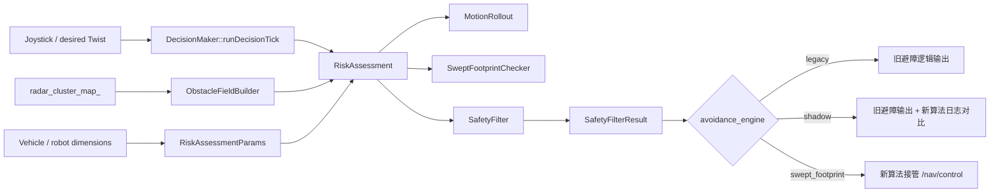

# 避障重构首轮修改技术文档

版本：v0.1  
日期：2026-06-05  
范围：`src/scene/scene_node`

## 1. 修改目标

本轮修改围绕“推翻重改避障相关内容”的第一阶段落地，目标不是继续修补旧的分方向距离/TTC 逻辑，而是引入一套新的轨迹级安全过滤框架：

- 从“聚类后按方向取最近距离 + TTC + 多段限速”改为“候选运动轨迹 + 车体扫掠 footprint + 安全过滤”。
- 支持 `legacy`、`shadow`、`swept_footprint` 三种运行模式，便于灰度验证和回滚。
- 将新避障算法做成纯逻辑模块，降低 `DecisionMaker` 内部避障逻辑重量。
- 默认仍保持旧输出，不改变现场行为；只有显式设置 `avoidance_engine=swept_footprint` 时才接管控制输出。

## 2. 总体架构



## 3. 新增模块

### 3.1 `avoidance_types`

文件：

- `include/avoidance_types.h`
- `src/avoidance_types.cpp`

职责：

- 定义新避障框架的数据结构。
- 包括 `MotionCommand`、`CandidateTrajectory`、`FootprintBox`、`ObstaclePrimitive`、`CollisionRisk`、`SafetyFilterResult` 等。
- 定义风险等级 `RiskLevel::{CLEAR, WARNING, LIMITING, BRAKING}`。

### 3.2 `MotionRollout`

文件：

- `include/motion_rollout.h`
- `src/motion_rollout.cpp`

职责：

- 输入期望线速度/角速度。
- 生成候选轨迹集合：
  - 原始指令轨迹。
  - 多档降线速度轨迹。
  - 原地旋转/降角速度轨迹。
  - 停车轨迹。
- 使用简化 unicycle 模型预测未来 `horizon_s` 时间内的车体位姿。

关键参数：

- `rollout_horizon_s`
- `rollout_dt_s`
- `rollout_speed_samples`
- `rollout_angular_samples`

### 3.3 `ObstacleFieldBuilder`

文件：

- `include/obstacle_field.h`
- `src/obstacle_field.cpp`

职责：

- 将 `radar_cluster_map_` 中的 `ClusterInfo` 转成轻量障碍物 `ObstaclePrimitive`。
- 按雷达时间戳过滤过期数据。
- 按距离排序并限制最大障碍物数量，避免人多场景下计算量失控。

关键参数：

- `swept_radar_timeout_s`
- `swept_max_obstacles`
- `footprint_obstacle_radius_default`

### 3.4 `SweptFootprintChecker`

文件：

- `include/swept_footprint_checker.h`
- `src/swept_footprint_checker.cpp`

职责：

- 对每条候选轨迹进行车体扫掠检测。
- 在每个预测位姿下，将障碍物变换到车体局部坐标系。
- 使用膨胀后的矩形 footprint 判断是否碰撞。
- 输出最早碰撞时间、碰撞点、最小 clearance 和风险等级。

与旧 TTC 的区别：

- 旧逻辑主要看当前速度方向上的最近距离/TTC。
- 新逻辑看“如果执行这个控制指令，未来轨迹上的车体包络是否会扫到障碍物”。
- 对转弯、斜向绕行、窄通道会更符合驾驶操作感。

### 3.5 `SafetyFilter`

文件：

- `include/safety_filter.h`
- `src/safety_filter.cpp`

职责：

- 从候选轨迹中选择安全且最接近用户意图的控制指令。
- 优先选择无碰撞轨迹。
- 如果所有候选轨迹都有风险，则选择 TTC 最大的轨迹。
- 若 TTC 低于紧急阈值，则输出停车。

关键参数：

- `safety_filter_angular_weight`
- `swept_emergency_ttc_s`

### 3.6 `RiskAssessment`

文件：

- `include/risk_assessment.h`
- `src/risk_assessment.cpp`

职责：

- 组合 `ObstacleFieldBuilder`、`MotionRollout`、`SweptFootprintChecker`、`SafetyFilter`。
- 对外提供一个统一接口：
  - 输入期望控制、车辆反馈、雷达聚类、雷达时间戳、当前时间和参数。
  - 输出 `SafetyFilterResult`。

## 4. `DecisionMaker` 接入方式

修改文件：

- `include/decision_maker.h`
- `src/decision_maker.cpp`

新增成员：

- `swept_risk_assessment_`
- `swept_avoidance_params_`
- `avoidance_engine_`
- `last_avoidance_engine_`
- `avoidance_shadow_log_`
- `swept_footprint_back_extent_`

新增方法：

- `declareSweptAvoidanceParams()`
- `updateSweptAvoidanceParamsFromRos()`
- `evaluateSweptAvoidance(...)`
- `smoothDecisionOutput(...)`
- `logSweptAvoidanceShadow(...)`

运行逻辑：

1. 每个 `runDecisionTick()` 读取当前 `avoidance_engine`。
2. 如果模式发生变化，调用 `resetBrakeHoldState()` 清理旧避障制动保持状态。
3. 当模式为 `shadow` 时：
   - 新算法并行计算。
   - 继续发布旧避障输出。
   - 打印 `[SweptAvoidance][shadow]` 对比日志。
4. 当模式为 `swept_footprint` 时：
   - 使用新算法输出的 `selected_command`。
   - 跳过旧的多方向距离/TTC 干预逻辑。
   - 经过同一个输出平滑/角速度硬限幅后发布。
   - 打印 `[SweptAvoidance][takeover]` 日志。
5. 当模式为 `legacy` 或非法值时：
   - 保持旧避障路径。
   - 非法值会 throttle warning 并 fallback 到 legacy。

## 5. 参数说明

配置文件：

- `config/decision_maker_params.yaml`
- `config/outdoor_default.yaml`

| 参数 | 默认值 | 说明 |
| --- | ---: | --- |
| `avoidance_engine` | `"legacy"` | `legacy` / `shadow` / `swept_footprint` |
| `avoidance_shadow_log` | `true` | 是否输出 shadow/takeover 对比日志 |
| `rollout_horizon_s` | `1.2` | 轨迹预测时域 |
| `rollout_dt_s` | `0.1` | 轨迹采样时间步长 |
| `rollout_speed_samples` | `6` | 降线速度候选数量 |
| `rollout_angular_samples` | `5` | 降角速度/原地旋转候选数量 |
| `swept_radar_timeout_s` | `0.15` | 新算法雷达数据超时阈值 |
| `swept_max_obstacles` | `128` | 新算法最多参与计算的障碍物数量 |
| `footprint_back_extent_m` | `0.25` | 后向 footprint 长度 |
| `footprint_front_margin` | `0.10` | 前向安全膨胀 |
| `footprint_back_margin` | `0.12` | 后向安全膨胀 |
| `footprint_side_margin` | `0.05` | 侧向安全膨胀 |
| `footprint_obstacle_radius_default` | `0.08` | 障碍物默认半径 |
| `comfort_clearance` | `0.30` | 舒适 clearance 阈值 |
| `swept_warning_ttc_s` | `1.5` | WARNING TTC 阈值 |
| `swept_limiting_ttc_s` | `1.0` | LIMITING TTC 阈值 |
| `swept_emergency_ttc_s` | `0.45` | BRAKING TTC 阈值 |
| `swept_hard_stop_distance_m` | `0.12` | 硬停车距离阈值 |
| `safety_filter_angular_weight` | `0.30` | 选择候选指令时角速度偏差权重 |

## 6. 启用与回滚

默认仍为旧逻辑：

```bash
ros2 param set /decision_maker avoidance_engine legacy
```

现场对比模式：

```bash
ros2 param set /decision_maker avoidance_engine shadow
```

新算法接管模式：

```bash
ros2 param set /decision_maker avoidance_engine swept_footprint
```

回滚：

```bash
ros2 param set /decision_maker avoidance_engine legacy
```

日志关键字：

```text
[SweptAvoidance][shadow]
[SweptAvoidance][takeover]
```

## 7. 构建与测试

已执行构建：

```bash
source /opt/ros/humble/setup.bash
colcon build --packages-up-to scene_node --cmake-args -DBUILD_TESTING=ON
```

结果：

- `common` 通过。
- `interface` 通过。
- `scene_node` 通过。

新增单测：

- `test/test_swept_avoidance.cpp`

覆盖内容：

- 空障碍场景下保持用户期望控制。
- 前方 footprint 内障碍物触发停车。

单独运行结果：

```text
[  PASSED  ] 2 tests.
```

完整测试：

```bash
source /opt/ros/humble/setup.bash
source install/setup.bash
colcon test --packages-select scene_node --event-handlers console_direct+
```

结果：

- GTest 通过。
- `xmllint` 通过。
- `lint_cmake` 通过。
- `uncrustify` 仍失败，但本轮新增避障文件和新增测试文件已无格式差异。
- 剩余失败来自仓库历史文件的格式差异，当前统计为 40 个文件。

## 8. 当前边界与风险

已完成：

- 新避障算法链路可独立运行。
- 新算法可 shadow 对比。
- 新算法可通过参数接管 `/nav/control`。
- 接管时会绕开旧的多方向距离/TTC 干预逻辑。
- 模式切换时会清理旧制动保持状态，避免状态串扰。

暂未完成：

- `RiskLevel` 到 `CollisionWarning/AuxiliaryAlarm` 的完整映射还未迁移。
- `VehicleFeedback` 已进入接口，但当前 rollout 仍主要按指令预测；下一阶段可加入真实速度、延迟和制动距离模型。
- 暂未加入动态障碍物速度估计。
- 暂未做现场 bag 回放统计报表。

需要重点实测：

- 人多密集场景下 `shadow` 日志中 selected command 与 legacy output 的差异。
- 窄通道慢速转弯是否减少误停。
- 原地旋转贴近障碍物时是否过于保守。
- 高速前进时 `swept_emergency_ttc_s` 和 `swept_hard_stop_distance_m` 是否需要上调。

## 9. 后续建议

第一步建议先跑 `shadow`：

1. 采集 10 到 20 分钟人多、窄通道、正常巡航三类场景日志。
2. 统计新旧输出差异：
   - 新算法建议停车但旧算法放行。
   - 旧算法停车但新算法给可绕行轨迹。
   - 两者都停车但 TTC/clearance 原因不同。
3. 根据日志调参：
   - 人多误停多：适当减小 `comfort_clearance` 或 obstacle radius。
   - 转弯贴边过保守：适当减小 `footprint_side_margin`。
   - 高速不够保守：增大 `swept_emergency_ttc_s` 或 `swept_hard_stop_distance_m`。
4. 再进入 `swept_footprint` 小范围接管。

第二步建议迁移告警：

- 将 `CollisionRisk.level` 映射到原有告警等级。
- 将 `risk.source`、`collision_x/y` 写入调试/诊断日志。
- 让 UI 能看到新算法接管原因。

第三步建议加入动态预测：

- 从 tracker 或连续 radar cluster 中估计障碍物相对速度。
- 将 `ObstaclePrimitive` 扩展为动态 primitive。
- 在 `SweptFootprintChecker` 中按 `pose.t` 推进障碍物位置。

