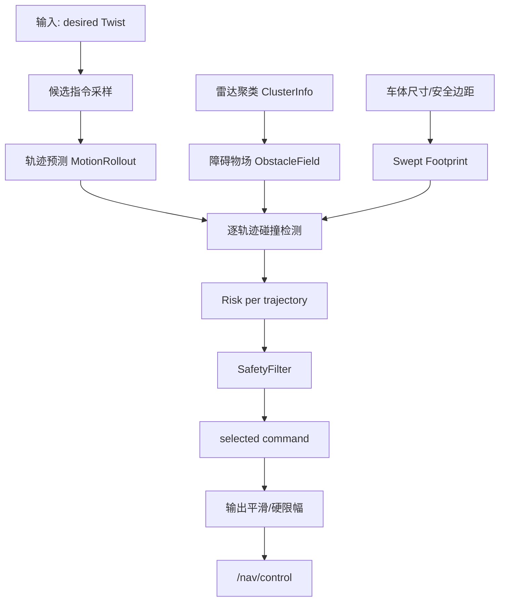

# 避障重构方案文档

版本：v0.1  
日期：2026-06-05  
范围：`src/scene/scene_node`  
目标模块：`DecisionMaker`、`RiskAssessment`、避障纯算法模块

## 1. 背景

当前避障逻辑以雷达聚类结果为输入，在 `DecisionMaker` 中按前向、后向、左侧、右侧分别计算最近距离，再结合线速度、角速度和 TTC 做分段限速/制动。该方案已经能覆盖基础安全，但在复杂场景中暴露出几个结构性问题：

- 人多场景下，聚类数量多且目标分布复杂，单纯取最近距离容易把可绕行空间判断成危险。
- 当前 TTC 与速度方向强绑定，转弯、斜向绕行、窄通道贴边时操作感偏重。
- 线速度/角速度被拆开判断，实际车体扫掠路径没有被完整建模。
- 旧逻辑耦合在 `DecisionMaker` 内部，包含方向距离、状态保持、速度恢复、TTC、倾斜雷达补偿等多层逻辑，继续修补会越来越重。
- 避障效果依赖大量阈值组合，现场调参难以形成稳定直觉。

因此本方案不再沿旧链路继续堆叠规则，而是将避障判断核心替换为“候选轨迹 + 车体扫掠 footprint + 安全过滤”的局部安全层。

## 2. 目标

### 2.1 功能目标

- 支持前进、后退、转弯、原地旋转等控制指令的轨迹级碰撞评估。
- 在人多或障碍分布复杂时，不只看最近点，而是判断可执行轨迹是否安全。
- 对用户输入做最小必要修改，优先保持操作意图。
- 在没有安全轨迹时输出停车。
- 支持 shadow 对比、灰度接管和快速回滚。

### 2.2 工程目标

- 将避障核心从 `DecisionMaker` 中拆出，形成可单测的纯算法模块。
- 保留旧避障作为回滚路径。
- 新旧逻辑通过参数切换，不要求一次性替换全部现场行为。
- 新增参数集中管理，便于后续调试和 A/B 对比。
- 后续可扩展动态障碍物预测、告警映射、bag 回放统计。

### 2.3 非目标

本阶段不做以下内容：

- 不重构感知聚类算法本身。
- 不重构 `Tracking`、`LidarDriver`、`SceneNode` 主框架。
- 不一次性删除旧避障逻辑。
- 不在第一阶段引入完整局部路径规划器。
- 不修改底盘控制协议。

## 3. 核心判断：当前“线速度 + 角速度判断碰撞”有什么问题

线速度和角速度本身不是问题，问题在于使用方式。

旧逻辑中，线速度通常用于前后向 TTC，角速度用于侧向 TTC 或转弯风险估计。这种拆分会带来误判：

- 同一个 `linear.x + angular.z` 指令实际对应一条弧线轨迹，不能简单拆成前向和侧向两个独立风险。
- 障碍物在车体前侧角落时，最近距离可能很近，但当前弧线轨迹可能不会撞到它。
- 反过来，障碍物当前不在正前方，但转弯扫掠时车体侧边可能会撞到。
- 原地旋转时线速度为 0，传统前向 TTC 近似失效，但车体 footprint 仍在扫掠空间。
- 使用当前反馈速度会滞后，使用指令速度会偏保守；二者都不能替代未来轨迹检测。

因此，新方案仍使用线速度和角速度作为运动输入，但不直接用它们判断碰撞，而是先生成未来轨迹，再用车体 footprint 沿轨迹扫掠检测。

## 4. 总体方案



核心思路：

1. 根据用户当前期望控制生成多条候选控制。
2. 对每条候选控制预测未来短时域轨迹。
3. 把雷达聚类转换成轻量障碍物场。
4. 沿每条轨迹移动机器人 footprint，判断是否扫到障碍物。
5. 从候选轨迹中选择“安全且最接近用户意图”的指令。
6. 没有安全轨迹时停车。

## 5. 模块设计

### 5.1 MotionRollout

职责：

- 输入 `MotionCommand{linear_x, angular_z}`。
- 输出候选轨迹集合。

候选策略：

- 保留原始控制。
- 逐档降低线速度，保留角速度。
- 原地旋转或逐档降低角速度。
- 加入停车候选。

收益：

- 用户想前进时，优先尝试低速前进。
- 用户想转弯时，优先保留转弯意图。
- 当前方不可通行但旋转安全时，允许旋转绕开。

### 5.2 ObstacleFieldBuilder

职责：

- 将 `radar_cluster_map_` 转换为 `ObstaclePrimitive`。
- 对雷达数据做时间过滤。
- 按距离排序并限制参与检测的障碍物数量。

设计原则：

- 不再把聚类结果直接当成方向距离。
- 每个聚类只作为空间障碍 primitive。
- 人多场景下限制最多参与计算的障碍物，避免计算量随人群数量失控。

### 5.3 SweptFootprintChecker

职责：

- 对每条轨迹做 footprint 扫掠碰撞检测。
- 输出该轨迹的风险等级、最小 clearance、TTC 和碰撞来源。

风险等级：

- `CLEAR`：轨迹安全。
- `WARNING`：clearance 偏小或 TTC 接近。
- `LIMITING`：需要明显限制。
- `BRAKING`：需要停车。

关键变化：

- 旧逻辑判断“障碍离哪个方向最近”。
- 新逻辑判断“执行这个控制会不会撞”。

### 5.4 SafetyFilter

职责：

- 从所有候选轨迹中选择最终控制。

选择规则：

1. 优先选择无碰撞轨迹。
2. 在无碰撞轨迹中选择最接近用户输入的指令。
3. 如果所有轨迹都有碰撞风险，选择 TTC 最大的轨迹。
4. 如果 TTC 低于紧急阈值，输出停车。

## 6. DecisionMaker 接入方案

### 6.1 模式设计

`avoidance_engine` 支持三种模式：

| 模式 | 行为 | 用途 |
| --- | --- | --- |
| `legacy` | 使用旧避障逻辑 | 默认安全回滚 |
| `shadow` | 新算法并行计算，只记录日志，输出仍为旧逻辑 | 现场对比 |
| `swept_footprint` | 新算法接管控制输出，跳过旧避障干预 | 灰度上线 |

### 6.2 legacy 模式

保持当前行为：

- 聚类合并。
- 分方向最近距离计算。
- 前/后/侧向 TTC。
- 状态保持。
- 速度恢复。
- 平滑输出。

### 6.3 shadow 模式

执行流程：

1. 旧避障逻辑正常运行并输出。
2. 新算法读取同一帧雷达聚类和控制输入。
3. 新算法计算建议输出。
4. 日志记录新旧差异。

日志字段：

- risk level
- emergency flag
- TTC
- clearance
- selected command
- legacy output
- obstacle count
- trajectory count
- collision source
- collision point

### 6.4 swept_footprint 模式

执行流程：

1. 新算法计算 `SafetyFilterResult`。
2. 使用 `selected_command` 替换输出控制。
3. 跳过旧的多方向避障干预。
4. 使用统一的输出平滑和角速度硬限幅。
5. 发布 `/nav/control`。

切换保护：

- 模式切换时清理旧的前向/后向制动保持状态。
- 非法模式 fallback 到 `legacy`。

## 7. 参数方案

### 7.1 运行模式参数

```yaml
avoidance_engine: "legacy"   # legacy / shadow / swept_footprint
avoidance_shadow_log: true
```

### 7.2 轨迹采样参数

```yaml
rollout_horizon_s: 1.2
rollout_dt_s: 0.1
rollout_speed_samples: 6
rollout_angular_samples: 5
```

建议：

- 人多低速场景可保持 `1.0~1.2s`。
- 高速场景可提高到 `1.5s`，但计算量会上升。
- `dt_s` 不建议低于 `0.05s`，否则 CPU 压力增加明显。

### 7.3 障碍物场参数

```yaml
swept_radar_timeout_s: 0.15
swept_max_obstacles: 128
footprint_obstacle_radius_default: 0.08
```

建议：

- 雷达频率稳定时可降低 timeout。
- 人多场景 CPU 压力大时优先降低 `swept_max_obstacles`。
- 障碍物偏保守时可降低 obstacle radius 或侧向 margin。

### 7.4 footprint 参数

```yaml
footprint_back_extent_m: 0.25
footprint_front_margin: 0.10
footprint_back_margin: 0.12
footprint_side_margin: 0.05
```

建议：

- 窄通道误停多：优先调小 `footprint_side_margin`。
- 前向制动距离不够：优先调大 `footprint_front_margin` 或 emergency TTC。
- 原地旋转过于保守：检查侧向 margin 和 obstacle radius。

### 7.5 风险阈值参数

```yaml
comfort_clearance: 0.30
swept_warning_ttc_s: 1.5
swept_limiting_ttc_s: 1.0
swept_emergency_ttc_s: 0.45
swept_hard_stop_distance_m: 0.12
safety_filter_angular_weight: 0.30
```

建议：

- 操作感太重：降低 `comfort_clearance`。
- 停车太晚：提高 `swept_emergency_ttc_s`。
- 太喜欢保留角速度导致贴边：提高 `safety_filter_angular_weight`。
- 太容易牺牲转向意图：降低 `safety_filter_angular_weight`。

## 8. 分阶段实施计划

### 阶段 0：代码落地

目标：

- 新增纯算法模块。
- 接入 `DecisionMaker`。
- 默认保持 `legacy`。
- 加入基础单测。

验收：

- `colcon build --packages-up-to scene_node` 通过。
- 新增 `test_swept_avoidance` 通过。
- `legacy` 模式下旧行为不变。

当前状态：

- 已完成。

### 阶段 1：shadow 对比

目标：

- 现场启用 `avoidance_engine=shadow`。
- 不接管控制，只采集新旧差异。

建议采集场景：

- 人多慢速穿行。
- 窄通道贴边。
- 原地旋转。
- 前进急停。
- 倒车靠近障碍物。

验收指标：

- 新算法不出现明显危险放行。
- 新算法在可绕行场景中比旧算法少误停。
- CPU 占用在可接受范围。
- 日志中 obstacle count 和 trajectory count 稳定。

### 阶段 2：小范围接管

目标：

- 在低速、室内、可控场景启用 `swept_footprint`。
- 保留随时切回 `legacy` 的回滚方式。

建议限制：

- 先限制最大速度。
- 先不在高速室外场景接管。
- 先不在坡道/特殊地面场景接管。

验收指标：

- 无碰撞风险。
- 操作员主观感受优于旧逻辑。
- 误停次数下降。
- 恢复/绕行动作更自然。

### 阶段 3：告警迁移

目标：

- 将 `RiskLevel` 映射到现有 `CollisionWarning` 和 `AuxiliaryAlarm`。
- UI 能显示新算法的风险来源。
- 日志能定位 collision source 和 collision point。

建议映射：

| RiskLevel | WarningLevel | 行为 |
| --- | --- | --- |
| `CLEAR` | NONE | 无告警 |
| `WARNING` | WARN | 提醒 |
| `LIMITING` | DECELERATE | 限速 |
| `BRAKING` | BRAKE | 制动 |

### 阶段 4：动态障碍物预测

目标：

- 从连续 cluster 或 tracking 中估计障碍物速度。
- 将静态 `ObstaclePrimitive` 扩展为动态 obstacle。
- 在 footprint 检测时按 `pose.t` 推进障碍物位置。

收益：

- 人群横穿时更早判断风险。
- 对移动障碍不会只看当前点位。
- TTC 与轨迹检测能统一起来。

## 9. 测试方案

### 9.1 单元测试

新增测试：

- 空场景保持期望控制。
- 前方 footprint 内障碍物触发停车。

后续建议补充：

- 左转时右侧障碍不误停。
- 左转时左前角障碍触发限制。
- 后退时后方障碍触发停车。
- 雷达超时数据被过滤。
- `swept_max_obstacles` 裁剪有效。

### 9.2 bag 回放测试

建议输出统计：

- 每帧 legacy output。
- 每帧 swept selected command。
- risk level 分布。
- emergency brake 次数。
- shadow 差异次数。
- 平均 trajectory count。
- 平均 obstacle count。
- 单帧计算耗时。

### 9.3 现场测试

建议顺序：

1. 静态障碍物靠近。
2. 原地旋转贴边。
3. 低速穿窄通道。
4. 人员横穿。
5. 多人站立干扰。
6. 倒车靠近。
7. 室外较高速前进。

## 10. 回滚方案

运行时回滚：

```bash
ros2 param set /decision_maker avoidance_engine legacy
```

配置文件回滚：

```yaml
avoidance_engine: "legacy"
```

代码层回滚：

- 保留旧避障逻辑。
- 新算法只通过 `avoidance_engine` 进入。
- 不影响旧参数和旧接口。

紧急策略：

- 如果新算法接管后出现操作异常，立即切回 `legacy`。
- 切换模式时会清理旧制动保持状态，避免控制状态残留。

## 11. 风险与对策

| 风险 | 表现 | 对策 |
| --- | --- | --- |
| footprint 过保守 | 窄通道误停 | 调小 side margin / obstacle radius |
| footprint 不够保守 | 贴边过近 | 调大 side/front margin |
| horizon 太短 | 高速停车晚 | 增大 horizon 或 emergency TTC |
| horizon 太长 | CPU 增加，动作保守 | 降低 horizon 或采样数 |
| 人多计算量大 | 单帧耗时高 | 限制 max obstacles |
| 动态障碍预测不足 | 横穿人员判断滞后 | 阶段 4 引入动态 obstacle |
| 告警缺失 | UI 不知道新算法原因 | 阶段 3 做 RiskLevel 映射 |

## 12. 验收标准

第一阶段验收：

- 默认 `legacy` 不改变现有行为。
- `shadow` 模式能稳定输出对比日志。
- `swept_footprint` 模式能接管控制。
- 新增单测通过。
- 构建通过。

第二阶段验收：

- 人多场景误停少于旧逻辑。
- 窄通道转向更顺。
- 无明显危险放行。
- 可通过参数快速回滚。

第三阶段验收：

- 告警/UI 与新算法风险一致。
- bag 回放能输出统计报表。
- 动态障碍物场景表现稳定。

## 13. 推荐上线顺序

```text
legacy 默认运行
  ↓
shadow 采集日志
  ↓
离线分析新旧差异
  ↓
低速小范围 swept_footprint 接管
  ↓
扩大场景
  ↓
迁移告警
  ↓
加入动态障碍预测
```

推荐第一轮现场参数：

```yaml
avoidance_engine: "shadow"
rollout_horizon_s: 1.2
rollout_dt_s: 0.1
swept_max_obstacles: 128
footprint_front_margin: 0.10
footprint_side_margin: 0.05
comfort_clearance: 0.30
swept_emergency_ttc_s: 0.45
```

推荐第一轮接管参数：

```yaml
avoidance_engine: "swept_footprint"
rollout_horizon_s: 1.2
rollout_dt_s: 0.1
swept_max_obstacles: 96
footprint_front_margin: 0.12
footprint_side_margin: 0.05
comfort_clearance: 0.25
swept_emergency_ttc_s: 0.50
```

